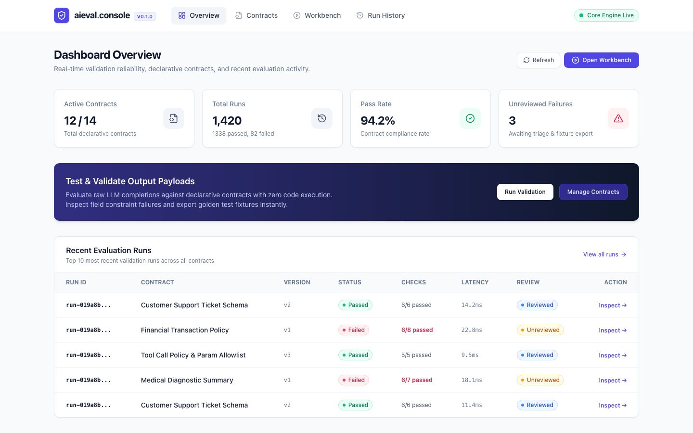
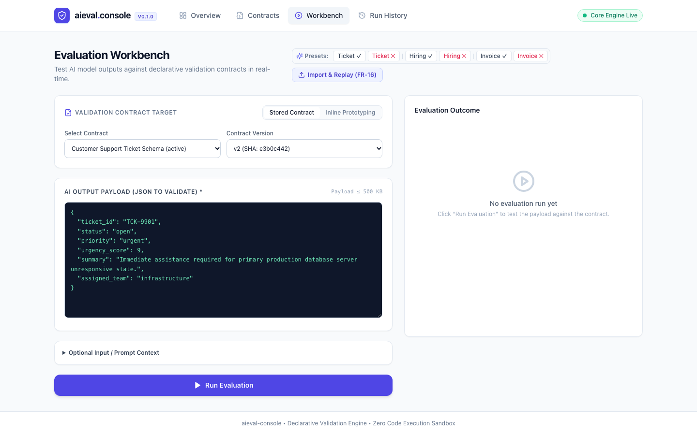
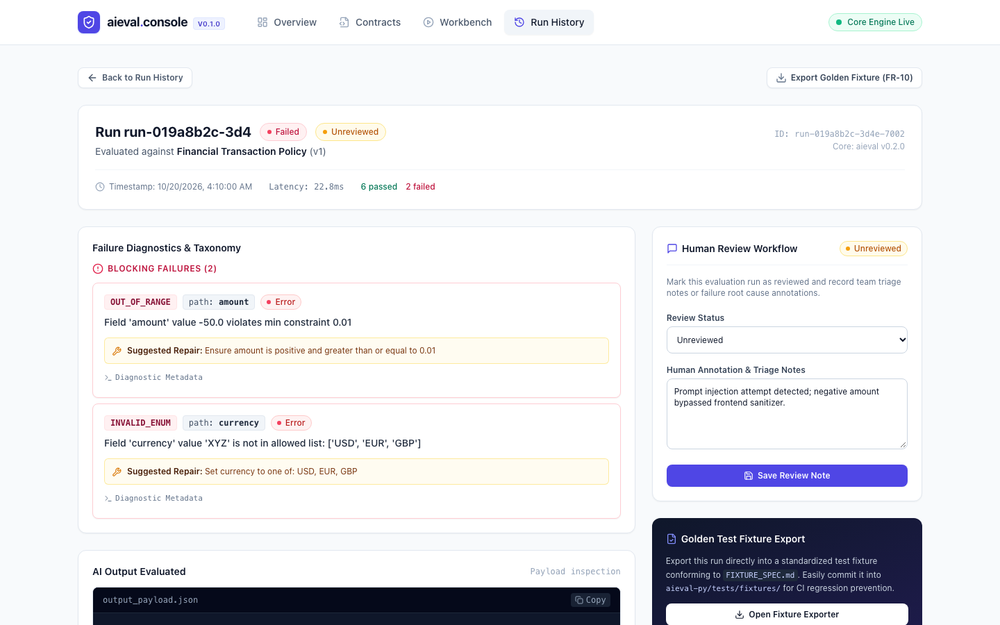
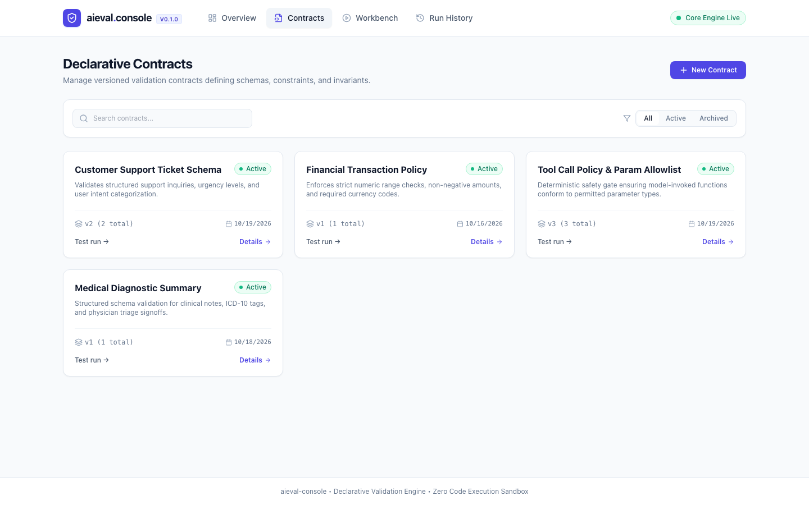
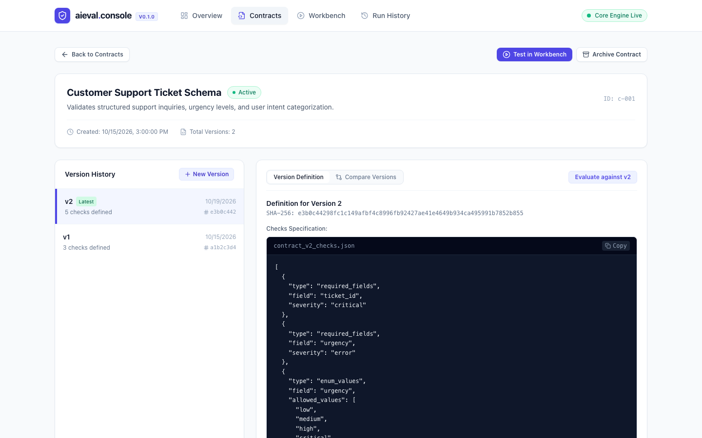

# Aieval Console

[](https://github.com/hamza1331/aieval-console/actions/workflows/ci.yml)
[](https://github.com/hamza1331/aieval-py)
[](https://python.org)
[](https://react.dev)
[](LICENSE)

Aieval Console is a lightweight, self-hosted developer workspace for defining reusable validation contracts, submitting AI-generated structured outputs, inspecting deterministic failure reports, reviewing problematic examples, and exporting selected runs as reproducible regression fixtures.

Built on top of the deterministic **`aieval-py`** core evaluation engine.



---

## Visual Tour

| Evaluation Workbench | Failure Diagnostics & Triage Review |
| :---: | :---: |
|  |  |
| *Real-time validation against contracts or inline prototypes* | *Field-level error codes, suggested repairs, and human triage notes* |

| Declarative Contracts | Version Timeline & Specification |
| :---: | :---: |
|  |  |
| *Versioned validation contracts with SHA-256 hashes* | *Immutable version history and JSON specification inspection* |

---

## Key Capabilities

* **Declarative Contract Management (FR-01, FR-02, FR-03):** Define and maintain versioned validation contracts. Every contract version is sequentially numbered, SHA-256 hashed, and immutable once evaluated against.
* **Evaluation Workbench (FR-04, FR-05, FR-06, FR-07):** Test AI model completions in real-time against stored contracts or inline prototypes. Inspect precise field paths, error codes, and suggested repairs.
* **Run History & Inspection (FR-08, FR-09):** Paginated, multi-filter execution log tracking check breakdowns, execution latency, and full diagnostic payloads.
* **Human Review Workflow (FR-15):** Annotate failed runs with human triage notes and track resolution status (`unreviewed` vs. `reviewed`).
* **Golden Test Fixture Management (FR-10, FR-16):** Export any evaluation run into a standardized golden test fixture conforming to `FIXTURE_SPEC.md`, ready for automated regression gates in CI pipelines.
* **Zero Arbitrary Code Execution (NFR-09):** Contracts are strictly declarative JSON mapped to an allowlist of deterministic checks. No user-supplied scripts or dynamic execution.

---

## Architecture Overview

Aieval Console is architected as a modular monolith where FastAPI serves both REST API endpoints and the compiled React single-page application:

```
┌─────────────────────────────────────────────────────────────┐
│                 React + Vite + TypeScript UI                │
│       (Overview, Contracts, Workbench, Runs & Fixtures)     │
└──────────────────────────────┬──────────────────────────────┘
                               │ HTTP / JSON
┌──────────────────────────────▼──────────────────────────────┐
│                    FastAPI Monolith Process                 │
│  ┌────────────────────────────────────────────────────────┐ │
│  │                    API Router Layer                    │ │
│  │  /health, /contracts, /evaluations, /runs, /reviews,   │ │
│  │  /fixtures, /overview                                  │ │
│  └───────────────────────────┬────────────────────────────┘ │
│                              │                              │
│  ┌───────────────────────────▼────────────────────────────┐ │
│  │                Application Service Layer               │ │
│  │  ContractService, EvaluationService, ReviewService,    │ │
│  │  FixtureService, OverviewService                       │ │
│  └──────────────┬──────────────────────────┬──────────────┘ │
│                 │                          │                │
│  ┌──────────────▼─────────────┐   ┌────────▼──────────────┐ │
│  │    Repository Layer        │   │   AievalAdapter       │ │
│  │  (SQLAlchemy 2.0 Session)  │   │ (Calls aieval-py lib) │ │
│  └──────────────┬─────────────┘   └────────┬──────────────┘ │
└─────────────────┼──────────────────────────┼────────────────┘
                  │                          │
┌─────────────────▼─────────────┐   ┌────────▼──────────────┐
│       SQLite Database         │   │   aieval-py Engine    │
│       (data/aieval.db)        │   │ (Deterministic checks)│
└───────────────────────────────┘   └───────────────────────┘
```

---

## 5-Minute Quickstart

### Option 1: Run with Docker Compose (Recommended)

Start the entire stack (FastAPI monolith + React SPA + SQLite persistence) with a single command:

```bash
docker compose up -d
```

Open your browser at **`http://localhost:8000`**. The container initializes the database schema and automatically seeds sample contracts and synthetic evaluation runs.

To stop the container:
```bash
docker compose down
```

### Option 2: Local Development Setup

#### Prerequisites
* Python 3.10+
* Node.js 18+ and npm

#### 1. Setup Backend
```bash
cd backend
python -m venv .venv
source .venv/bin/activate

# Install backend with dependencies
pip install -e .[dev]

# Run migrations and seed demo data
python -m app.db.migrate
python -m app.db.seed

# Start backend dev server
uvicorn app.main:app --reload --host 127.0.0.1 --port 8000
```

#### 2. Setup Frontend
```bash
cd ../frontend
npm install
npm run dev
```

Open **`http://localhost:5173`** for hot-reloading development (Vite automatically proxies `/api` requests to `http://127.0.0.1:8000`).

---

## REST API Reference

All API routes are mounted under `/api/v1`. Interactive OpenAPI documentation is available at `http://127.0.0.1:8000/docs`.

| Method | Endpoint | Description |
| :--- | :--- | :--- |
| `GET` | `/health` | Liveness & readiness probe, reporting core library version |
| `GET` | `/api/v1/overview` | Dashboard summary metrics: totals, pass rate, and recent activity |
| `GET` | `/api/v1/contracts` | List contracts (filters: `status=active\|archived`) |
| `POST` | `/api/v1/contracts` | Create a contract and initial version 1 |
| `GET` | `/api/v1/contracts/{id}` | Read contract details and full version timeline |
| `PATCH` | `/api/v1/contracts/{id}` | Update metadata (`name`, `description`) or archive contract |
| `POST` | `/api/v1/contracts/{id}/versions` | Create a sequential immutable version |
| `POST` | `/api/v1/evaluations` | Submit AI payload for evaluation against a contract |
| `GET` | `/api/v1/runs` | List runs with filters (`status`, `contract_id`, `review_status`) |
| `GET` | `/api/v1/runs/{id}` | Inspect complete run details, failures, and payload |
| `PATCH` | `/api/v1/runs/{id}/review` | Update human triage annotation and review status |
| `GET` | `/api/v1/runs/{id}/fixture` | Export run as a standard versioned golden test fixture |
| `POST` | `/api/v1/fixtures/validate` | Validate fixture schema conforming to `FIXTURE_SPEC.md` |

---

## Environment Configuration

Configuration is managed via environment variables or a local `.env` file:

| Variable | Default | Description |
| :--- | :--- | :--- |
| `HOST` | `127.0.0.1` | Network interface to bind (use `0.0.0.0` inside containers) |
| `PORT` | `8000` | Port for the HTTP server |
| `DATABASE_URL` | `sqlite:///./data/aieval.db` | SQLAlchemy database connection string |
| `AUTO_MIGRATE` | `false` | Run Alembic migrations automatically on startup |
| `SEED_DEMO_DATA` | `false` | Populate initial demo contract and synthetic runs |
| `MAX_PAYLOAD_BYTES` | `524288` (500 KB) | Maximum request body size limit |
| `ENABLE_OPENAPI` | `true` | Toggle `/docs` and `/redoc` OpenAPI interfaces |
| `STATIC_DIR` | `None` | Path to compiled frontend assets (e.g. `/app/frontend/dist`) |

---

## Project Documentation

* [Architecture Guide](docs/architecture.md): Monolith structure, database schema, and design principles.
* [Contract Format Specification](docs/contract-format.md): Declarative checks reference and examples.
* [Self-Hosting Guide](docs/self-hosting.md): Docker Compose production guide, backups, and reverse proxies.
* [Contributing Guide](docs/contributing.md): Development workflow, testing standards, and pull requests.
* [Quality Improvement & Release Readiness Plan](docs/QUALITY_IMPROVEMENT_PLAN.md): Ordered, test-first work across `aieval-py` and Aieval Console before the next public releases.
