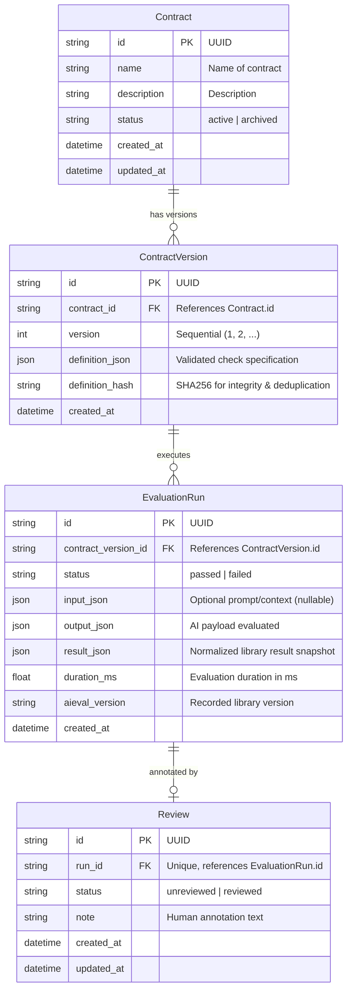

# Comprehensive Implementation Plan: Aieval Console

> Historical planning snapshot. Use [QUALITY_IMPROVEMENT_PLAN.md](./QUALITY_IMPROVEMENT_PLAN.md) for current implementation and release status.

**Document Version:** 1.1  
**Project:** Aieval Console  
**Target Delivery:** 4-Week Phased Milestone Plan (Single Developer, Part-Time)  
**Stack:** FastAPI + `aieval-py` + SQLAlchemy 2.x + SQLite + React/Vite/TypeScript + Docker Compose  
**References:** Aieval Console SRS v0.1 (14 October 2026), `aieval-py` Fixture Spec v1.0  

---

## 1. Executive Summary & Architecture Overview

Aieval Console is a lightweight, self-hosted developer workspace for defining reusable validation contracts, submitting AI-generated structured outputs, inspecting deterministic failure reports, reviewing problematic examples, and exporting selected runs as reproducible regression fixtures.

### 1.1 Core Architectural Principles
1. **Library as Source of Truth (FR-05, SRS Sec 5):** `aieval-py` is the sole source of truth for evaluation behavior, failure codes, and severity semantics. The application never silently reimplements or duplicates evaluation logic.
2. **Modular Monolith (SRS Sec 9.1):** A single FastAPI application serves API endpoints and static frontend assets (in production). Clean separation between routers, schemas, services, repositories, and adapters.
3. **Contract Immutability (FR-03, SRS Sec 10.1):** Contract versions are immutable once created. A run strictly binds to the exact `contract_version_id` used. Editing a contract produces a new sequential version.
4. **Local-First & Zero Secrets (SRS Sec 14):** Binds to `127.0.0.1` by default. Core functionality and CI tests require no cloud provider API keys, no network access, and no external queue/worker infrastructure.
5. **No Arbitrary Code Execution (NFR-09, SRS Sec 14):** Contracts are purely declarative JSON mapped to an allowlist of supported checks. No user-supplied Python, scripts, or arbitrary dynamic class generation.

### 1.2 System Architecture Diagram

```
┌─────────────────────────────────────────────────────────────┐
│                   React + Vite + TypeScript UI              │
│       (Overview, Contracts, Workbench, Runs & Fixtures)     │
└──────────────────────────────┬──────────────────────────────┘
                               │ HTTP / JSON
┌──────────────────────────────▼──────────────────────────────┐
│                    FastAPI Monolith Process                 │
│  ┌────────────────────────────────────────────────────────┐ │
│  │                    API Router Layer                    │ │
│  │  /health, /contracts, /evaluations, /runs, /reviews,   │ │
│  │  /fixtures, /overview                                  │ │
│  └───────────────────────────┬────────────────────────────┘ │
│                              │                              │
│  ┌───────────────────────────▼────────────────────────────┐ │
│  │                Application Service Layer               │ │
│  │  ContractService, EvaluationService, ReviewService,    │ │
│  │  FixtureService, OverviewService                       │ │
│  └──────────────┬──────────────────────────┬──────────────┘ │
│                 │                          │                │
│  ┌──────────────▼─────────────┐   ┌────────▼──────────────┐ │
│  │    Repository Layer        │   │  aieval_adapter.py    │ │
│  │  (SQLAlchemy 2.x Session)  │   │ (Calls aieval-py lib) │ │
│  └──────────────┬─────────────┘   └────────┬──────────────┘ │
└─────────────────┼──────────────────────────┼────────────────┘
                  │                          │
┌─────────────────▼─────────────┐   ┌────────▼──────────────┐
│       SQLite Database         │   │   aieval-py Engine    │
│  (Contracts, Versions, Runs)  │   │  (Public check specs) │
└───────────────────────────────┘   └───────────────────────┘
```

---

## 2. Workspace & Repository Layout

The project resides in a dedicated repository `aieval-console` positioned adjacent to `aieval-py`:

```text
aieval-python/
├── aieval-py/                               # Core Python validation library
│   ├── src/aieval/
│   │   ├── checks/                          # Base & constraint checks
│   │   ├── domain/                          # Failure, Context, Result, Severity
│   │   ├── specs/                           # Public check spec factory (Phase 1)
│   │   │   └── factory.py
│   │   └── cli/                             # Library CLI runner
│   └── tests/
│       ├── fixtures/                        # Golden cross-language fixtures
│       └── unit/
└── aieval-console/                          # Application repository
    ├── docs/                                # Project documentation
    │   ├── COMPREHENSIVE_IMPLEMENTATION_PLAN.md
    │   ├── PHASE_1_PLAN.md
    │   ├── architecture.md
    │   ├── contract-format.md
    │   ├── self-hosting.md
    │   └── contributing.md
    ├── backend/
    │   ├── pyproject.toml                   # uv project config & dependencies
    │   ├── alembic.ini
    │   ├── alembic/                         # Database migrations
    │   │   ├── env.py
    │   │   └── versions/
    │   ├── app/
    │   │   ├── main.py                      # FastAPI app factory & lifespan
    │   │   ├── core/
    │   │   │   ├── config.py                # Pydantic BaseSettings
    │   │   │   ├── logging.py               # Privacy-preserving structured logging
    │   │   │   └── middleware.py            # Payload limits & error sanitization
    │   │   ├── db/
    │   │   │   ├── base.py                  # SQLAlchemy DeclarativeBase
    │   │   │   ├── session.py               # Engine & sessionmaker dependency
    │   │   │   └── seed.py                  # Demo contract & synthetic runs seeder (FR-13)
    │   │   ├── models/                      # SQLAlchemy ORM models
    │   │   │   ├── contract.py
    │   │   │   ├── contract_version.py
    │   │   │   ├── evaluation_run.py
    │   │   │   └── review.py
    │   │   ├── schemas/                     # Pydantic v2 schemas
    │   │   │   ├── common.py                # Pagination & base schemas
    │   │   │   ├── contract.py              # Declarative contract schemas
    │   │   │   ├── evaluation.py            # Evaluation request/response
    │   │   │   ├── run.py                   # Run history & filters
    │   │   │   ├── review.py                # Review notes & status
    │   │   │   ├── fixture.py               # Fixture export & validation schemas
    │   │   │   └── overview.py              # Dashboard summary totals schema
    │   │   ├── repositories/                # Database persistence layer
    │   │   │   ├── contract_repo.py
    │   │   │   ├── run_repo.py
    │   │   │   └── review_repo.py
    │   │   ├── adapters/
    │   │   │   └── aieval_adapter.py        # Maps contract specs to aieval-py checks
    │   │   ├── services/                    # Business logic layer
    │   │   │   ├── contract_service.py
    │   │   │   ├── evaluation_service.py
    │   │   │   ├── review_service.py
    │   │   │   ├── fixture_service.py
    │   │   │   └── overview_service.py
    │   │   └── api/
    │   │       ├── router.py                # Consolidated v1 router
    │   │       └── routes/
    │   │           ├── health.py            # Health & version endpoint (FR-14)
    │   │           ├── contracts.py         # Contract CRUD & versioning (FR-01, FR-02)
    │   │           ├── evaluations.py       # Run execution (FR-04)
    │   │           ├── runs.py              # Run history & inspect (FR-08)
    │   │           ├── reviews.py           # Review notes & marking (FR-09)
    │   │           ├── fixtures.py          # Fixture export & validate (FR-10, FR-16)
    │   │           └── overview.py          # Dashboard totals & recent stats (FR-11)
    │   └── tests/
    │       ├── conftest.py
    │       ├── unit/
    │       ├── api/
    │       └── integration/
    ├── frontend/
    │   ├── package.json
    │   ├── vite.config.ts
    │   ├── index.html
    │   └── src/
    │       ├── api/                         # Typed backend API client
    │       ├── components/                  # UI elements (tables, badges, JSON editor)
    │       ├── pages/
    │       │   ├── OverviewPage.tsx         # FR-11 dashboard totals & recent activity
    │       │   ├── ContractsPage.tsx        # Contract list, create, archive
    │       │   ├── ContractDetailPage.tsx   # Versions, spec viewer, editor
    │       │   ├── EvaluationWorkbench.tsx  # Interactive output tester
    │       │   ├── RunHistoryPage.tsx       # Filterable runs list
    │       │   └── RunDetailPage.tsx        # Failure breakdown, review note, fixture export
    │       └── types/                       # TypeScript models
    ├── examples/                            # Demo domains (SRS Sec 3.2)
    │   ├── support-ticket-classification/
    │   └── recruitment-screening/
    ├── fixtures/                            # Test fixtures
    │   └── v1/
    ├── docker/
    │   ├── compose.yaml                     # Production Compose setup
    │   └── Dockerfile                       # Multi-stage backend + static frontend build
    ├── .env.example
    ├── .github/workflows/ci.yml
    ├── README.md
    ├── CONTRIBUTING.md
    ├── CODE_OF_CONDUCT.md
    └── LICENSE
```

---

## 3. Declarative Contract Specification & Supported Allowlist

To prevent arbitrary code execution (NFR-09, SRS Sec 17) while enabling full UI authoring, contracts are defined as a declarative JSON structure strictly validated via Pydantic v2 schemas.

### 3.1 Supported Check Allowlist

| Check `type` | Aliases | Required Parameters | Optional Parameters | Mapped `aieval-py` Call |
| :--- | :--- | :--- | :--- | :--- |
| `required_fields` | `required` | `fields: list[str]` | `severity: Severity` | `required_fields(fields, severity=...)` |
| `allowed_fields` | `whitelist_fields`| `fields: list[str]` | `severity: Severity` | `allowed_fields(fields, severity=...)` |
| `enum` | `allowed_values` | `allowed: list[Any]` | `field: str`, `severity: Severity` | `allowed_values(allowed, field=..., severity=...)` |
| `max_length` | `max_len` | `max: int` | `field: str`, `severity: Severity` | `length_bounds(max_len=..., field=..., severity=...)` |
| `min_length` | `min_len` | `min: int` | `field: str`, `severity: Severity` | `length_bounds(min_len=..., field=..., severity=...)` |
| `length_bounds`| `length` | none | `min_len: int`, `max_len: int`, `field: str`, `severity: Severity` | `length_bounds(...)` |
| `numeric_range`| `range` | none | `min_val: float`, `max_val: float`, `field: str`, `severity: Severity` | `numeric_range(...)` |
| `regex_match` | `regex`, `pattern`| `pattern: str` | `field: str`, `severity: Severity` | `regex_match(pattern, field=..., severity=...)` |
| `valid_json` | `json` | none | `severity: Severity` | `valid_json(severity=...)` |
| `tool_call` | `tool` | `name: str` | `required_args: list[str]`, `allow_unexpected_args: bool`, `severity` | `tool_call_check(...)` |

### 3.2 Canonical Contract JSON (Support Ticket Appendix A)

```json
{
  "name": "Support ticket classification",
  "description": "Validate structured output from a ticket classifier",
  "checks": [
    {
      "type": "required_fields",
      "fields": ["category", "priority", "summary"]
    },
    {
      "type": "enum",
      "field": "category",
      "allowed": ["billing", "technical", "account", "other"]
    },
    {
      "type": "enum",
      "field": "priority",
      "allowed": ["low", "normal", "high", "urgent"]
    },
    {
      "type": "max_length",
      "field": "summary",
      "max": 300
    }
  ]
}
```

---

## 4. Data Model & Storage Rules

### 4.1 Relational Schema



### 4.2 Storage Rules
1. **Identifier Standard:** All primary keys exposed externally are UUIDv4 strings.
2. **Version Immutability (FR-03, NFR-05):** Once a `ContractVersion` is referenced by an `EvaluationRun`, it is permanently immutable. Attempts to modify it return HTTP 409 Conflict.
3. **Soft-Delete / Archival (FR-01):** Contracts with associated runs cannot be deleted; they transition to `status="archived"`.
4. **Snapshot Guarantee (NFR-04, SRS Sec 10.1):** `result_json` stores the exact serialized `EvaluationResult` at evaluation time. Future upgrades of `aieval-py` do not retroactively alter stored historical run results.
5. **Auditing & Version Tracking:** Every run captures the exact `aieval_version` (e.g., `"0.1.1"`) in `EvaluationRun.aieval_version`.

---

## 5. Complete API Surface Specification

All endpoints are mounted under `/api/v1`.

| Method | Path | Summary & Purpose | SRS Priority |
| :--- | :--- | :--- | :--- |
| `GET` | `/api/v1/health` | Readiness & liveness summary; reports DB status & library version (FR-14) | Must |
| `POST` | `/api/v1/contracts` | Create contract and initial version 1 (FR-01) | Must |
| `GET` | `/api/v1/contracts` | List contracts (filters: `status=active\|archived`) | Must |
| `GET` | `/api/v1/contracts/{id}` | Get contract details with latest version and version history list | Must |
| `PATCH` | `/api/v1/contracts/{id}` | Update contract metadata (`name`, `description`, `status`) or archive (FR-01) | Must |
| `POST` | `/api/v1/contracts/{id}/versions` | Create a new immutable version for an existing contract (FR-01, FR-03) | Must |
| `GET` | `/api/v1/contracts/{id}/versions/{version}` | Read definition of a specific contract version | Must |
| `POST` | `/api/v1/evaluations` | Evaluate output payload against a contract version and persist run (FR-04, FR-07) | Must |
| `GET` | `/api/v1/runs` | List runs (pagination: `limit`, `offset`; filters: `contract_id`, `status`, `from_date`, `to_date`) | Must |
| `GET` | `/api/v1/runs/{id}` | Get run details, normalized failures, and review status (FR-08) | Must |
| `PATCH` | `/api/v1/runs/{id}/review` | Add/update review note and toggle reviewed status (FR-09) | Must |
| `GET` | `/api/v1/runs/{id}/fixture` | Export run as a standard versioned golden test fixture JSON (FR-10) | Must |
| `POST` | `/api/v1/fixtures/validate` | Validate fixture format without executing arbitrary code (FR-16) | Should |
| `GET` | `/api/v1/overview` | Dashboard summary metrics: totals, pass rate, and recent activity (FR-11) | Should |

---

## 6. Fixture Export & Interoperability Specification

In accordance with FR-10 and `aieval-py/FIXTURE_SPEC.md`, `GET /api/v1/runs/{id}/fixture` generates a golden fixture JSON compatible with both the TypeScript and Python CLI runners (`aieval run fixture.json`):

```json
{
  "name": "fixture_run_c1a2b3c4",
  "description": "Regression fixture exported from Aieval Console run c1a2b3c4-...",
  "context": {
    "input": { "task": "classify_support_ticket" },
    "metadata": {
      "contract_name": "Support ticket classification",
      "contract_version": 1,
      "console_run_id": "c1a2b3c4-5d6e-7f8a-9b0c-1d2e3f4a5b6c"
    }
  },
  "output": {
    "category": "billing",
    "priority": "urgent_now",
    "summary": "Customer billing inquiry"
  },
  "checks": [
    {
      "type": "required_fields",
      "fields": ["category", "priority", "summary"]
    },
    {
      "type": "enum",
      "field": "category",
      "allowed": ["billing", "technical", "account", "other"]
    },
    {
      "type": "enum",
      "field": "priority",
      "allowed": ["low", "normal", "high", "urgent"]
    },
    {
      "type": "max_length",
      "field": "summary",
      "max": 300
    }
  ],
  "expected": {
    "passed": false,
    "failures": [
      {
        "code": "ENUM_MISMATCH",
        "path": "priority",
        "severity": "error"
      }
    ]
  }
}
```

Database-internal surrogate keys are excluded from the exported schema.

---

## 7. Non-Functional & Operational Requirements Implementation

1. **Payload Limits (NFR-07):** A FastAPI middleware inspects `Content-Length`. Requests exceeding `MAX_PAYLOAD_BYTES` (default 500 KB) return `413 Request Entity Too Large`.
2. **Error Sanitization (NFR-04):** A global exception handler catches unhandled exceptions, logs the full stack trace internally with request ID, and returns a sanitized JSON response:
   ```json
   {
     "detail": "An internal error occurred. Please reference error ID: <uuid>"
   }
   ```
3. **Privacy-Conscious Logging (NFR-08):** Request logging captures timestamp, method, path, status, duration, and client IP. Full prompt and output payloads are never written to standard application logs.
4. **Local-First Security (NFR-09):** The application binds to `127.0.0.1` by default. Startup banners and documentation explicitly note that v0.1 has no authentication and is intended for local or trusted private network use.
5. **API Documentation Control (FR-15, NFR-15):** The OpenAPI docs (`/docs` and `/redoc`) are controlled via `ENABLE_OPENAPI: bool = True` in settings, allowing production deployments to disable docs if desired.
6. **Demo Seeding (FR-13):** A repeatable CLI command (`python -m app.db.seed`) populates the database with the Appendix A Support Ticket classifier contract, versions, and realistic passing and failing runs.

---

## 8. Four-Week Milestone Delivery Roadmap

### Week 1 — Learn FastAPI & Prove Library Integration
- **Goal:** Establish developer environment, enhance `aieval-py` with field-targeted checks and public spec factory, build backend scaffold and working adapter.
- **Deliverables:**
  1. `aieval-py` field-targeting support (`field: str | None = None`) for constraint checks.
  2. Public `build_check_from_spec` factory exported from `aieval`.
  3. `aieval-py` CLI updated to use public spec factory.
  4. Backend skeleton using `uv`, Pydantic v2 settings, CORS, and logging.
  5. `GET /api/v1/health` endpoint reporting `aieval` version.
  6. `aieval_adapter.py` mapping declarative contract specs to `aieval-py` checks.
  7. In-memory `POST /api/v1/evaluations` validating the Appendix A Support Ticket classifier.
  8. Milestone 1.5 Architecture Spike Note (`docs/SPIKE_FINDINGS.md`).

### Week 2 — Persistence & Core Backend Workflow
- **Goal:** Full database persistence, migrations, contract versioning, run history, and demo seeding.
- **Deliverables:**
  1. SQLAlchemy 2.0 async/sync engine, session dependency injection, and initial Alembic migration.
  2. ORM models: `Contract`, `ContractVersion`, `EvaluationRun`, `Review`.
  3. Repositories and Services for Contracts, Runs, and Reviews.
  4. REST routes: Contracts CRUD & archive, Version creation, Evaluation execution with persistence, and Run history with date/status filters.
  5. Repeatable demo seeder (`python -m app.db.seed`) for the Support Ticket classifier.
  6. Integration test suite with temporary SQLite database and `TestClient`.

### Week 3 — Review Workflow & Frontend Dashboard
- **Goal:** Interactive single-page React application for contracts, live evaluation, failure review, and fixture export.
- **Deliverables:**
  1. Vite + React + TypeScript shell with typed API client.
  2. **Overview Screen (FR-11):** Basic totals, pass/fail rates, recent runs, and `GET /api/v1/overview` API.
  3. **Contracts Screen (FR-01, FR-02):** List, create, view versions, and archive contracts.
  4. **Evaluation Workbench (FR-04):** Test output against contracts with visual error badges and path indicators.
  5. **Run History & Detail Inspector (FR-08, FR-09):** Paginated filterable runs, failure inspection, and review notes.
  6. **Fixture Export & Validation (FR-10, FR-16):** Download versioned JSON fixtures and `POST /api/v1/fixtures/validate`.

### Week 4 — Self-Hosting, Hardening & Release
- **Goal:** Docker Compose deployment, payload security, documentation, CI, and release packaging.
- **Deliverables:**
  1. Multi-stage `Dockerfile` (frontend build + FastAPI runner) and `docker/compose.yaml` with SQLite volume persistence.
  2. Operational hardening: payload size limits, sanitized 500 error handler, privacy-preserving logging.
  3. GitHub Actions CI pipeline testing backend lint/test and frontend build.
  4. Complete documentation: `README.md`, `architecture.md`, `contract-format.md`, `self-hosting.md`, `contributing.md`.
  5. Release candidate v0.1.0 packaging with sample fixtures and issue templates.

---

## 9. Acceptance Criteria & Definition of Done

- [ ] Clean clone starts via documented local commands or `docker compose up`.
- [ ] Developer can create a contract, submit valid output, and see a passing result in under 10 minutes.
- [ ] Submitting invalid output produces structured failures directly from `aieval-py`.
- [ ] Every persisted run links to an immutable `contract_version_id`.
- [ ] Database data persists across container restarts.
- [ ] Failed runs can be annotated with review notes and exported as standard fixtures.
- [ ] Exported fixtures can be executed by `aieval-py` CLI without errors.
- [ ] 100% of core CI tests pass without API keys or internet access.
- [ ] Request bodies exceeding size limits return 413, and server errors return sanitized 500 responses.
