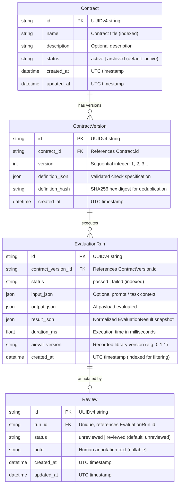

# Phase 2 Plan: Database Persistence, Contract Versioning & Run History

**Milestone:** Week 2 Delivery  
**Project:** Aieval Console  
**Target Architecture:** FastAPI + SQLAlchemy 2.x + SQLite + Alembic  
**References:** Aieval Console SRS v0.1 (Sections 6, 7, 8, 10, 11, 15), `COMPREHENSIVE_IMPLEMENTATION_PLAN.md`  

---

## 1. Executive Summary & Phase 2 Objectives

Phase 2 transitions Aieval Console from an in-memory integration spike into a persistent developer platform. It implements relational database persistence using SQLAlchemy 2.0 and Alembic on SQLite, guarantees contract version immutability, persists evaluation snapshots with the integrated library version, delivers paginated run history with filtering, and provides repeatable demo seeding.

### Key Phase 2 Deliverables
1. **Database Infrastructure & Migrations:**
   - SQLAlchemy 2.0 engine, scoped sessionmaker, and `get_db` FastAPI dependency injection.
   - SQLite foreign key enforcement (`PRAGMA foreign_keys = ON;`).
   - Alembic migration environment and baseline schema migration (`0001_initial_schema.py`).
2. **Relational Data Models (ORM):**
   - `Contract`: Logical contract identity with lifecycle status (`active`, `archived`).
   - `ContractVersion`: Immutable definition snapshot with SHA-256 integrity hash.
   - `EvaluationRun`: Persisted run execution with bounded input/output, result snapshot, duration, and `aieval_version`.
   - `Review`: Human annotation note and reviewed status linked to an evaluation run.
3. **Repository & Service Layer:**
   - `ContractRepository` & `ContractService`: Contract CRUD, archival rules, and sequential version incrementing.
   - `RunRepository` & `EvaluationService`: Evaluation execution, result snapshot persistence, and run listing with multi-criteria filtering.
   - `ReviewRepository` & `ReviewService`: Run review note management and status toggling.
4. **Complete REST Endpoints:**
   - `POST /api/v1/contracts`: Create contract + initial version 1.
   - `GET /api/v1/contracts`: List contracts (with status filtering).
   - `GET /api/v1/contracts/{id}`: Get contract detail and version history.
   - `PATCH /api/v1/contracts/{id}`: Update metadata or archive contract (FR-01).
   - `POST /api/v1/contracts/{id}/versions`: Create sequential immutable version (FR-03).
   - `GET /api/v1/contracts/{id}/versions/{version}`: Read specific version definition.
   - `POST /api/v1/evaluations`: Evaluate payload against persisted contract and record run (FR-04, FR-07).
   - `GET /api/v1/runs`: List runs with pagination and filters (`contract_id`, `status`, `from_date`, `to_date`) (FR-08, FR-12).
   - `GET /api/v1/runs/{id}`: Detailed run inspection with failure breakdown and review (FR-08).
   - `PATCH /api/v1/runs/{id}/review`: Add/update review note and reviewed status (FR-09).
5. **Repeatable Demo Seeding (FR-13):**
   - CLI command (`python -m app.db.seed`) populating the Appendix A Support Ticket classifier, versions, and realistic passing and failing runs.
6. **Comprehensive Automated Test Suite:**
   - Integration tests covering migration execution, database constraints, foreign keys, transaction rollbacks, version immutability, and API workflows using temporary SQLite databases.

---

## 2. Database Schema & Storage Rules

### 2.1 Entity Relationship Diagram



### 2.2 Storage Rules & Integrity Constraints
1. **Identifier Standard:** All primary keys are UUIDv4 strings generated application-side or in the database.
2. **Version Immutability (FR-03, NFR-05):**
   - Unique constraint on `(contract_id, version)`.
   - Once a `ContractVersion` is referenced by an `EvaluationRun`, it is permanently immutable. Attempts to modify or delete it return HTTP 409 Conflict.
3. **Soft-Delete / Archival (FR-01):**
   - Contracts with associated runs cannot be destructively deleted; instead, `PATCH /api/v1/contracts/{id}` sets `status="archived"`.
   - Archived contracts remain readable for historical runs, but cannot be selected for new evaluations unless explicitly unarchived.
4. **Historical Snapshot Fidelity (NFR-04, SRS Sec 10.1):**
   - `result_json` stores the exact serialized `EvaluationResult` at run time. If the `aieval-py` library is updated in the future, past run results will never drift.
   - `aieval_version` records the library version (e.g., `"0.1.1"`) present when the run was evaluated.
5. **SQLite Foreign Key Enforcement:**
   - SQLite does not enforce foreign keys by default. The engine connection listener will execute `PRAGMA foreign_keys = ON;` on every SQLite connection.

---

## 3. Package & Environment Updates

### 3.1 Dependencies in `backend/pyproject.toml`
Add persistence dependencies:
```toml
dependencies = [
    "fastapi>=0.110.0",
    "uvicorn[standard]>=0.28.0",
    "pydantic>=2.6.0",
    "pydantic-settings>=2.2.0",
    "sqlalchemy>=2.0.28",
    "alembic>=1.13.1",
    "aieval-py",
]
```

### 3.2 Configuration Settings (`app/core/config.py`)
Add database settings:
```python
DATABASE_URL: str = "sqlite:///./data/aieval.db"
```
Ensure `./data/` directory is automatically created if missing.

---

## 4. Module Architecture & File Layout

```text
backend/
├── alembic.ini
├── alembic/
│   ├── env.py                       # Configured with SQLAlchemy Base.metadata
│   ├── script.py.mako
│   └── versions/
│       └── 0001_initial_schema.py    # Baseline migration for tables & indices
├── app/
│   ├── core/
│   │   ├── config.py                # Adds DATABASE_URL
│   │   ├── logging.py
│   │   └── middleware.py
│   ├── db/
│   │   ├── __init__.py
│   │   ├── base.py                  # DeclarativeBase model registry
│   │   ├── session.py               # Engine, sessionmaker, get_db dependency
│   │   └── seed.py                  # Demo seeder CLI (FR-13)
│   ├── models/
│   │   ├── __init__.py              # Re-exports all models for Alembic discovery
│   │   ├── contract.py              # Contract ORM model
│   │   ├── contract_version.py      # ContractVersion ORM model
│   │   ├── evaluation_run.py        # EvaluationRun ORM model
│   │   └── review.py                # Review ORM model
│   ├── schemas/
│   │   ├── common.py                # PaginatedResponse[T]
│   │   ├── contract.py              # ContractCreate, ContractUpdate, ContractResponse
│   │   ├── evaluation.py            # EvaluationRequest, EvaluationResponse
│   │   ├── run.py                   # RunSummary, RunDetailResponse, RunFilterParams
│   │   └── review.py                # ReviewUpdateRequest, ReviewResponse
│   ├── repositories/
│   │   ├── __init__.py
│   │   ├── contract_repo.py         # Contract & ContractVersion DB queries
│   │   ├── run_repo.py              # EvaluationRun DB queries & filters
│   │   └── review_repo.py           # Review DB queries
│   ├── services/
│   │   ├── __init__.py
│   │   ├── contract_service.py      # Contract business logic & versioning
│   │   ├── evaluation_service.py    # Evaluation execution & run persistence
│   │   └── review_service.py        # Review note management
│   ├── adapters/
│   │   └── aieval_adapter.py        # Bridge to aieval-py
│   └── api/
│       ├── router.py                # Consolidates health, contracts, evaluations, runs, reviews
│       └── routes/
│           ├── health.py            # Reports health, DB connectivity, aieval version
│           ├── contracts.py         # Contract CRUD & versioning
│           ├── evaluations.py       # Run execution
│           ├── runs.py              # Run history & inspection
│           └── reviews.py           # Review management
└── tests/
    ├── conftest.py                  # In-memory SQLite engine & session overrides
    ├── unit/
    │   ├── test_contract_service.py
    │   └── test_evaluation_service.py
    ├── api/
    │   ├── test_contracts_api.py
    │   ├── test_evaluations_api.py
    │   ├── test_runs_api.py
    │   └── test_reviews_api.py
    └── integration/
        ├── test_db_migrations.py
        └── test_full_workflow.py
```

---

## 5. Detailed Component Specifications

### 5.1 Database Session Management (`app/db/session.py`)
```python
from sqlalchemy import create_engine, event
from sqlalchemy.orm import sessionmaker, Session
from app.core.config import settings

connect_args = {"check_same_thread": False} if settings.DATABASE_URL.startswith("sqlite") else {}

engine = create_engine(
    settings.DATABASE_URL,
    connect_args=connect_args,
    echo=False,
)

# Enable foreign keys for SQLite
if settings.DATABASE_URL.startswith("sqlite"):
    @event.listens_for(engine, "connect")
    def set_sqlite_pragma(dbapi_connection, connection_record):
        cursor = dbapi_connection.cursor()
        cursor.execute("PRAGMA foreign_keys=ON")
        cursor.close()

SessionLocal = sessionmaker(autocommit=False, autoflush=False, bind=engine)

def get_db() -> Generator[Session, None, None]:
    """FastAPI dependency yielding a managed transactional database session."""
    db = SessionLocal()
    try:
        yield db
    finally:
        db.close()
```

### 5.2 ORM Models Specification

1. **`Contract` (`app/models/contract.py`)**:
   - `id: Mapped[str] = mapped_column(String(36), primary_key=True, default=lambda: str(uuid.uuid4()))`
   - `name: Mapped[str] = mapped_column(String(200), nullable=False, index=True)`
   - `description: Mapped[str | None] = mapped_column(Text, nullable=True)`
   - `status: Mapped[str] = mapped_column(String(20), nullable=False, default="active", index=True)`
   - `created_at: Mapped[datetime] = mapped_column(DateTime(timezone=True), default=datetime.utcnow)`
   - `updated_at: Mapped[datetime] = mapped_column(DateTime(timezone=True), default=datetime.utcnow, onupdate=datetime.utcnow)`
   - Relationships: `versions: Mapped[list["ContractVersion"]] = relationship(back_populates="contract", cascade="all, delete-orphan", order_by="ContractVersion.version.desc()")`

2. **`ContractVersion` (`app/models/contract_version.py`)**:
   - `id: Mapped[str] = mapped_column(String(36), primary_key=True, default=lambda: str(uuid.uuid4()))`
   - `contract_id: Mapped[str] = mapped_column(String(36), ForeignKey("contracts.id", ondelete="CASCADE"), nullable=False, index=True)`
   - `version: Mapped[int] = mapped_column(Integer, nullable=False)`
   - `definition_json: Mapped[dict[str, Any]] = mapped_column(JSON, nullable=False)`
   - `definition_hash: Mapped[str] = mapped_column(String(64), nullable=False)`
   - `created_at: Mapped[datetime] = mapped_column(DateTime(timezone=True), default=datetime.utcnow)`
   - Constraints: `UniqueConstraint("contract_id", "version", name="uq_contract_version")`
   - Relationships: `contract: Mapped["Contract"] = relationship(back_populates="versions")`, `runs: Mapped[list["EvaluationRun"]] = relationship(back_populates="contract_version")`

3. **`EvaluationRun` (`app/models/evaluation_run.py`)**:
   - `id: Mapped[str] = mapped_column(String(36), primary_key=True, default=lambda: str(uuid.uuid4()))`
   - `contract_version_id: Mapped[str] = mapped_column(String(36), ForeignKey("contract_versions.id", ondelete="RESTRICT"), nullable=False, index=True)`
   - `status: Mapped[str] = mapped_column(String(20), nullable=False, index=True)`
   - `input_json: Mapped[dict[str, Any] | None] = mapped_column(JSON, nullable=True)`
   - `output_json: Mapped[Any] = mapped_column(JSON, nullable=False)`
   - `result_json: Mapped[dict[str, Any]] = mapped_column(JSON, nullable=False)`
   - `duration_ms: Mapped[float] = mapped_column(Float, nullable=False)`
   - `aieval_version: Mapped[str] = mapped_column(String(30), nullable=False)`
   - `created_at: Mapped[datetime] = mapped_column(DateTime(timezone=True), default=datetime.utcnow, index=True)`
   - Relationships: `contract_version: Mapped["ContractVersion"] = relationship(back_populates="runs")`, `review: Mapped["Review | None"] = relationship(back_populates="run", uselist=False, cascade="all, delete-orphan")`

4. **`Review` (`app/models/review.py`)**:
   - `id: Mapped[str] = mapped_column(String(36), primary_key=True, default=lambda: str(uuid.uuid4()))`
   - `run_id: Mapped[str] = mapped_column(String(36), ForeignKey("evaluation_runs.id", ondelete="CASCADE"), unique=True, nullable=False, index=True)`
   - `status: Mapped[str] = mapped_column(String(20), nullable=False, default="unreviewed", index=True)`
   - `note: Mapped[str | None] = mapped_column(Text, nullable=True)`
   - `created_at: Mapped[datetime] = mapped_column(DateTime(timezone=True), default=datetime.utcnow)`
   - `updated_at: Mapped[datetime] = mapped_column(DateTime(timezone=True), default=datetime.utcnow, onupdate=datetime.utcnow)`
   - Relationships: `run: Mapped["EvaluationRun"] = relationship(back_populates="review")`

---

### 5.3 Service Layer Implementation Details

#### `ContractService`
- **`create_contract(name, description, checks)`:**
  1. Validates `checks` through `aieval.build_check_from_spec`. If any check fails, raises `ValidationError`.
  2. Computes `definition_hash = hashlib.sha256(canonical_json(checks)).hexdigest()`.
  3. Creates `Contract` record (`status="active"`).
  4. Creates `ContractVersion` record (`version=1`).
  5. Commits transaction and returns composite schema.
- **`create_new_version(contract_id, checks)`:**
  1. Fetches contract. If not found or archived, raises appropriate error.
  2. Validates checks via `aieval.build_check_from_spec`.
  3. Computes `definition_hash`.
  4. Finds highest current version $V$. Assigns next version $V + 1$.
  5. Creates immutable `ContractVersion` record and commits.
- **`archive_contract(contract_id)`:**
  1. Sets `contract.status = "archived"`.
  2. Commits and returns updated contract.
  3. Prevents destructive deletion if runs reference any version.

#### `EvaluationService`
- **`execute_and_persist_evaluation(contract_version_id, contract_id, input_payload, output_payload)`:**
  1. Resolves contract version:
     - If `contract_version_id` provided: loads `ContractVersion`.
     - Elif `contract_id` provided: loads latest active `ContractVersion`.
     - Else raises 400 Bad Request.
  2. Runs evaluation using `AievalAdapter.evaluate(output_payload, checks_spec=version.definition_json["checks"], context_data={"input": input_payload})`.
  3. Creates `EvaluationRun` record:
     - `status`: `"passed"` or `"failed"`
     - `input_json`: `input_payload`
     - `output_json`: `output_payload`
     - `result_json`: `result.to_dict()` snapshot
     - `duration_ms`: duration
     - `aieval_version`: `aieval.__version__`
  4. Creates default `Review(run_id=run.id, status="unreviewed")`.
  5. Commits transaction and returns `EvaluationResponse` with persistent `run_id`.

#### `ReviewService`
- **`update_review(run_id, status, note)`:**
  1. Loads `Review` for run. If run doesn't exist, raises 404.
  2. Updates `status` ("unreviewed" | "reviewed") and `note`.
  3. Updates `updated_at` timestamp.
  4. Commits and returns updated review.

---

### 5.4 API Route Definitions

| Method | Path | Request Body | Response Body | Description |
| :--- | :--- | :--- | :--- | :--- |
| `POST` | `/api/v1/contracts` | `ContractCreateRequest` | `ContractDetailResponse` | Create contract & initial version 1 |
| `GET` | `/api/v1/contracts` | Query: `status`, `limit`, `offset` | `PaginatedResponse[ContractSummaryResponse]` | List contracts with latest version number |
| `GET` | `/api/v1/contracts/{id}` | None | `ContractDetailResponse` | Get contract metadata & all versions list |
| `PATCH`| `/api/v1/contracts/{id}` | `ContractUpdateRequest` | `ContractDetailResponse` | Update name, description, or status (archive) |
| `POST` | `/api/v1/contracts/{id}/versions` | `ContractVersionCreateRequest`| `ContractVersionResponse` | Create next immutable version |
| `GET` | `/api/v1/contracts/{id}/versions/{v}` | None | `ContractVersionResponse` | Retrieve specific version definition |
| `POST` | `/api/v1/evaluations` | `EvaluationRequest` | `EvaluationResponse` | Evaluate output and persist run |
| `GET` | `/api/v1/runs` | Query: `contract_id`, `status`, `from_date`, `to_date`, `limit`, `offset` | `PaginatedResponse[RunSummaryResponse]` | List historical runs with filters |
| `GET` | `/api/v1/runs/{id}` | None | `RunDetailResponse` | Inspect run, failure list, and review |
| `PATCH`| `/api/v1/runs/{id}/review` | `ReviewUpdateRequest` | `ReviewResponse` | Annotate run and mark reviewed |

---

### 5.5 Demo Seeding Script (`app/db/seed.py` - FR-13)

Command: `python -m app.db.seed`

The seeder provides a repeatable demonstration setup:
1. Creates the **Support Ticket Classification** contract (Appendix A).
2. Generates initial version 1 (`required_fields`, `enum` on category, `enum` on priority, `max_length` on summary).
3. Inserts 5 realistic synthetic runs:
   - **Run 1 (Passed):** Billing inquiry with `urgent` priority and short summary.
   - **Run 2 (Passed):** Technical bug report with `normal` priority.
   - **Run 3 (Failed - Enum):** Support ticket with invalid priority `"emergency_now"`.
   - **Run 4 (Failed - Missing Field):** Support ticket omitting the `summary` field.
   - **Run 5 (Failed - Max Length):** Support ticket with summary exceeding 300 characters.
4. Marks Run 3 as reviewed with human note: `"Model hallucinated priority string. Needs prompt constraint adjustment."`
5. Idempotent execution: if the demo contract already exists, reports status without duplicating records.

---

## 6. Implementation Step-by-Step Checklist

### Step 1: Dependencies & Database Foundation
- [ ] Add `sqlalchemy>=2.0.28` and `alembic>=1.13.1` to `backend/pyproject.toml`.
- [ ] Install dependencies in `backend/.venv`.
- [ ] Configure `DATABASE_URL` in `app/core/config.py`.
- [ ] Implement `app/db/base.py` and `app/db/session.py` with SQLite foreign key listener.
- [ ] Initialize Alembic (`alembic init alembic`) and configure `alembic/env.py` with SQLAlchemy Base.
- [ ] Generate migration `0001_initial_schema.py` creating `contracts`, `contract_versions`, `evaluation_runs`, `reviews`.
- [ ] Apply migration and verify SQLite tables and foreign keys.

### Step 2: ORM Models & Repositories
- [ ] Implement ORM models: `Contract`, `ContractVersion`, `EvaluationRun`, `Review`.
- [ ] Implement `ContractRepository` (create, get, list, archive, versioning).
- [ ] Implement `RunRepository` (create run, get, list with multi-column filtering and pagination).
- [ ] Implement `ReviewRepository` (create or update review).

### Step 3: Service Layer & Business Rules
- [ ] Implement `ContractService` with Pydantic validation via `aieval.build_check_from_spec` and SHA-256 deduplication.
- [ ] Implement `EvaluationService` mapping evaluation payloads to `AievalAdapter`, persisting run snapshots, and linking reviews.
- [ ] Implement `ReviewService` managing review annotations.

### Step 4: REST API Endpoints
- [ ] Update `app/schemas/` with contract, run, and review schemas.
- [ ] Implement `app/api/routes/contracts.py` (CRUD, versions, archive).
- [ ] Update `app/api/routes/evaluations.py` to persist runs via `EvaluationService`.
- [ ] Implement `app/api/routes/runs.py` (paginated list with filters, detail inspection).
- [ ] Implement `app/api/routes/reviews.py` (PATCH review note/status).
- [ ] Register new routes in `app/api/router.py`.

### Step 5: Demo Seeder CLI (FR-13)
- [ ] Implement `app/db/seed.py` with repeatable Support Ticket classifier demo.
- [ ] Verify execution via `python -m app.db.seed`.

### Step 6: Test Suite & Quality Verification
- [ ] Configure `conftest.py` with transactional SQLite in-memory engine and session dependency overrides.
- [ ] Write tests for Contract CRUD, version sequential increment, and archival.
- [ ] Write tests for version immutability and foreign key cascade/restrict rules.
- [ ] Write tests for evaluation persistence, result snapshot reproducibility, and run history filtering.
- [ ] Write tests for review note update and status toggling.
- [ ] Verify `pytest`, `ruff check`, and `mypy app` with 100% pass and 0 errors.

---

## 7. Acceptance Criteria for Phase 2 Completion

1. **ORM & Migrations:** Clean SQLite database initializes from Alembic migrations without manual SQL.
2. **Contract Lifecycle:** Developer can create contracts, view versions, increment versions sequentially, and archive contracts.
3. **Version Immutability:** Existing contract versions referenced by runs cannot be altered or deleted.
4. **Run Persistence:** Submitting outputs through `POST /api/v1/evaluations` generates persistent `EvaluationRun` records storing exact snapshots of inputs, outputs, and `aieval-py` failure reports.
5. **Run History & Filtering:** `GET /api/v1/runs` supports filtering by `contract_id`, `status` ("passed" | "failed"), and date ranges with correct pagination counts.
6. **Review Workflow:** `PATCH /api/v1/runs/{id}/review` updates human notes and reviewed status, surviving application and container restarts.
7. **Demo Seeding:** `python -m app.db.seed` seeds realistic demo data reliably and idempotently.
8. **Automated Tests:** 100% of integration and API tests pass using isolated test databases without external credentials.

