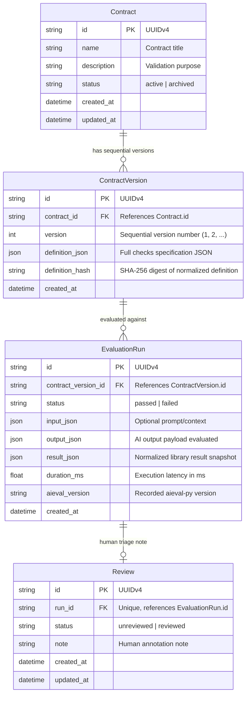

# Aieval Console Architecture Specification

## 1. Core Architectural Principles

1. **Library as Source of Truth (FR-05):** `aieval-py` is the sole source of truth for check execution, failure codes, and severity semantics. The console adapter maps declarative contracts into public `aieval` check specifications without reimplementing evaluation logic.
2. **Modular Monolith:** A single FastAPI application serves API endpoints, business logic, persistence repositories, and static frontend assets in production.
3. **Contract Immutability (FR-03):** Contract versions are sequentially numbered, SHA-256 hashed, and immutable once evaluated against. Any changes to a contract generate a new sequential version.
4. **Snapshot Guarantee:** Historical evaluation runs store the serialized library result at evaluation time. Future upgrades of `aieval-py` do not retroactively modify stored historical outcomes.
5. **Local-First & Zero Secrets (NFR-09):** The application requires no cloud provider credentials, external databases, or network access to operate.

---

## 2. Entity-Relationship Data Model



---

## 3. Layered Component Architecture

```
                    ┌─────────────────────────┐
                    │  React Single Page App  │
                    └───────────┬─────────────┘
                                │ JSON / HTTP
                    ┌───────────▼─────────────┐
                    │   FastAPI API Router    │
                    └───────────┬─────────────┘
                                │
                    ┌───────────▼─────────────┐
                    │    Application Layer    │
                    │   (Services & Domain)   │
                    └──────┬───────────┬──────┘
                           │           │
         ┌─────────────────▼──┐     ┌──▼───────────────────┐
         │  Repository Layer  │     │    AievalAdapter     │
         │  (SQLAlchemy 2.0)  │     │(Calls aieval-py lib) │
         └─────────┬──────────┘     └──┬───────────────────┘
                   │                   │
         ┌─────────▼──────────┐     ┌──▼───────────────────┐
         │  SQLite Database   │     │  aieval-py Core Lib  │
         └────────────────────┘     └──────────────────────┘
```

### Layer Responsibilities

* **API Routers (`app/api/routes/`):** Request validation, status code translation, and HTTP response serialization using Pydantic v2 schemas.
* **Services (`app/services/`):** Business logic, contract version sequencing, SHA-256 hashing, fixture synthesis, and overview aggregations.
* **Adapter (`app/adapters/aieval_adapter.py`):** Translates declarative check dictionaries into executable `aieval-py` check instances using the public `build_check_from_spec` factory.
* **Repositories (`app/repositories/`):** Database queries using SQLAlchemy 2.0 type-safe `select()` statements with pagination and filter criteria.
* **Database Session (`app/db/session.py`):** Managed SQLite connections with `PRAGMA foreign_keys = ON` and connection pooling.
